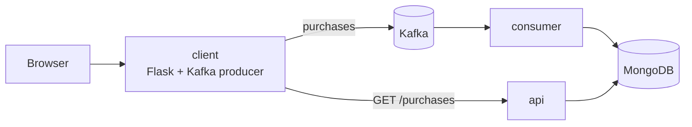

# Marvellous Mischief Co. 🎆

The shop front of a magical joke shop, built as an educational DevOps project: Flask, Kafka and MongoDB, containerised, then moved to Azure Kubernetes Service with Terraform, Azure Pipelines and Argo CD.

**Status (2026-11-28):**

- **Application:** complete. Purchases flow browser → client → Kafka → consumer → MongoDB, and the order history reads back through the API. 111 automated tests.
- **Local:** the whole stack runs with one `docker compose up`.
- **Azure:** Terraform, the GitOps repository and the CI pipeline are written. The bootstrap stack is applied. The dev cluster does not fit the 4 vCPU Free Trial quota yet, so it has not run end to end. See [`docs/PROJECT_STATUS.md`](docs/PROJECT_STATUS.md).



On Azure:

- the same services run on AKS;
- Kafka is managed by Strimzi; MongoDB is a StatefulSet;
- Argo CD deploys them from a separate GitOps repository, [`gitops-shop`](https://github.com/yaninagroisman/gitops-shop);
- Azure Pipelines builds, scans and signs the images;
- Kyverno admits only images signed with the project key.

Details: [`docs/ARCHITECTURE.md`](docs/ARCHITECTURE.md).

## Documentation

| File | What it is |
|---|---|
| [`docs/ROADMAP.md`](docs/ROADMAP.md) | Master roadmap: the single source of truth for tasks |
| [`docs/PROJECT_STATUS.md`](docs/PROJECT_STATUS.md) | Current phase, progress, next tasks |
| [`docs/ARCHITECTURE.md`](docs/ARCHITECTURE.md) | Application, local and Azure architecture, delivery flow, production design |
| [`docs/API.md`](docs/API.md) · [`docs/DATABASE.md`](docs/DATABASE.md) | API contract and MongoDB schema |
| [`docs/FEATURES.md`](docs/FEATURES.md) | What works, what is partial, what is planned |
| [`docs/DESIGN_SYSTEM.md`](docs/DESIGN_SYSTEM.md) | Tokens, components, imagery rules |
| [`docs/DEPLOYMENT.md`](docs/DEPLOYMENT.md) | How to run locally and how to deploy to Azure |
| [`docs/SECURITY.md`](docs/SECURITY.md) · [`docs/TESTING.md`](docs/TESTING.md) | Security controls and gaps, tests and static checks |
| [`terraform/bootstrap/README.md`](terraform/bootstrap/README.md) · [`terraform/environments/dev/README.md`](terraform/environments/dev/README.md) | Terraform stacks |
| [`docs/COMMERCIAL_READINESS.md`](docs/COMMERCIAL_READINESS.md) | Readiness checklist and risk register |
| [`docs/DECISIONS.md`](docs/DECISIONS.md) | Decision log, including the Azure architecture decisions (AD-xx) |
| [`docs/HANDOVER.md`](docs/HANDOVER.md) · [`docs/PRODUCT_VISION.md`](docs/PRODUCT_VISION.md) | Handover, vision |
| [`REPORT.md`](REPORT.md) | Detailed work log (Russian) |

## Run it

Full stack (Docker Compose):

```bash
docker compose up -d --build
```

Open <http://localhost:8080>. Purchases go through Kafka and MongoDB.

Frontend only, with purchases simulated in the browser:

```bash
cd client
python -m venv .venv && source .venv/bin/activate
pip install -r requirements.txt
flask --app wsgi run --debug
```

Open <http://127.0.0.1:5000>. Azure deployment: [`docs/DEPLOYMENT.md`](docs/DEPLOYMENT.md) §2.

## Tests

```bash
cd api    && pip install -r requirements-dev.txt && pytest     # 36 tests
cd client && pip install -r requirements-dev.txt && playwright install chromium && pytest   # 75 tests
```

The same tests, plus lint, a secret scan and an image vulnerability scan, run in Azure Pipelines (`.azure-pipelines/ci.yml`). See [`docs/TESTING.md`](docs/TESTING.md).

## Pages

| Page | URL |
|---|---|
| Shop window: animated storefront | `/` |
| Catalogue: search, shelf filters, sorting | `/catalogue` |
| Product page with live preview and a "demonstrate" button | `/product/<slug>` |
| **The Mischief Ledger**: the enchanted ledger of purchases | `/orders` |

## Project layout

```
client/                   shop front (Flask) + Kafka producer for POST /api/buy
  wsgi.py                 app = create_app()
  producer.py             idempotent Kafka producer
  kafka_config.py         Kafka security settings from env
  tests/                  pytest + Playwright
  app/
    __init__.py           app factory, template helpers, security headers
    config.py             API_MODE, POLL_INTERVAL_MS (from environment variables)
    routes.py             pages, POST /api/buy, GET /api/purchases (proxy to api)
    catalog.py            product data: 13 products, texts, prices, effects
    money.py              Griffins / Shards / Pips (1 Griffin = 12 Shards = 240 Pips)
    templates/            pages and partials
    static/css/main.css   the whole visual design
    static/js/            api.js (the one backend seam), mock-api.js, basket, ledger, game, effects
    static/fonts/, img/   self-hosted fonts (OFL) and photographs
api/                      purchases API (GET /purchases) + Kafka consumer, one image
compose.yaml              local stack: mongodb, kafka, kafka-init, api, consumer, client
.azure-pipelines/ci.yml   CI: lint, tests, Trivy, push, Cosign signing, GitOps tag bump
terraform/                bootstrap/ (state, identities, Azure DevOps), environments/dev/, modules/
docs/                     documentation
```

## Purchases: mock or real backend

All purchase calls go through `window.ShopAPI` in `static/js/api.js`:

```js
ShopAPI.buy(product, quantity)   // -> Promise<Purchase>, status "pending"
ShopAPI.getAllBoughtItems()      // -> Promise<Purchase[]>, newest first
```

```jsonc
// Purchase
{
  "id": "…", "product_slug": "pocket-fluffs", "product_name": "Pocket Fluffs",
  "quantity": 2, "unit_price": 300, "total_price": 600,    // in Pips
  "status": "pending" | "completed" | "failed",
  "failure_reason": null,                                   // text when failed
  "created_at": "2026-11-25T10:00:00Z", "updated_at": "…"
}
```

`pending` means the order was **accepted** but not yet **processed**. The UI keeps re-reading `getAllBoughtItems()` every `POLL_INTERVAL_MS` until each order is `completed` (fireworks) or `failed` (error with the reason). That matches an asynchronous Kafka flow.

Switch modes with the `API_MODE` environment variable (no code changes):

| `API_MODE` | What happens |
|---|---|
| `mock` (default) | `mock-api.js` simulates orders in `localStorage`: accepted in about 0.5 s, processed after 3–7 s, about 10% fail |
| `http` (compose, AKS) | The browser calls **same-origin** endpoints served by the client server: |

```
POST /api/buy         {"product_slug": "pocket-fluffs", "quantity": 2}
                      → 202  {"purchase": Purchase}   (or a bare Purchase)
GET  /api/purchases   → 200  {"purchases": [Purchase, …]}   (or a bare array)
```

`POST /api/buy` publishes the order to Kafka; `GET /api/purchases` is proxied to the api, which reads MongoDB. Contract: [`docs/API.md`](docs/API.md). No hostnames are hard-coded anywhere.

Mock demo switches (add to any URL): `?mock=fail` (every new order fails), `?mock=ok` (none fail), `?mock=reset` (clear the history).

## Things to discover 🤫

- Move your mouse near a **Pocket Fluff**. Click it.
- Hover over the **Long-Reach Listeners** and the **Truant's Tuckbox** (or tap the Tuckbox on the home page); on product pages press the demo button.
- Push the shop door in the storefront photo: the stock escapes, and you have 30 seconds to catch it (mini-game, `static/js/game.js`). Typing `reserare` just unlocks the door.
- Throw a pinch of **Instant Midnight Powder**.
- Type `lucerna` (then `umbra`). Type `reserare` on the home page, or `advenio` anywhere.
- Type *nothing up my sleeve* to unfold the Prowler's Chart (and *all clear* to fold it), or find the footprints in the footer.
- Knock on the swinging shop sign three times.
- Watch the family clock while an order is in flight.
- Mysterious footprints wander across the page now and then.
- With *prefers-reduced-motion* enabled, all of the movement switches off.

*© Marvellous Mischief Co. All mischief is fictional and all Griffins are imaginary.*

> **Images:** all product photos and the storefront were replaced with versions branded "Marvellous Mischief Co." (checked visually on 2026-11-25).
