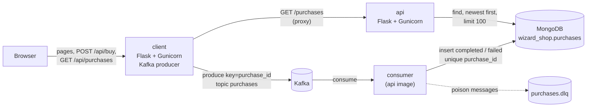
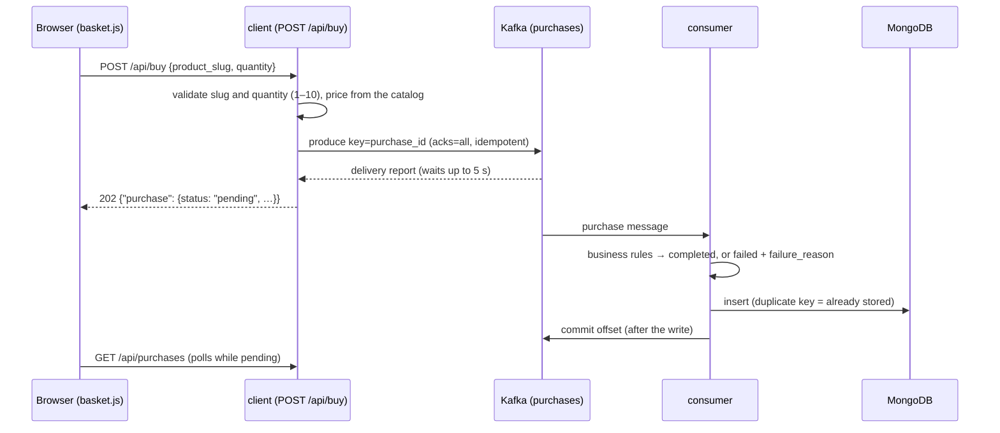
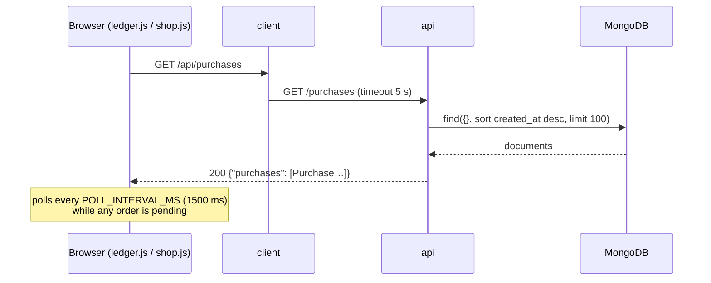
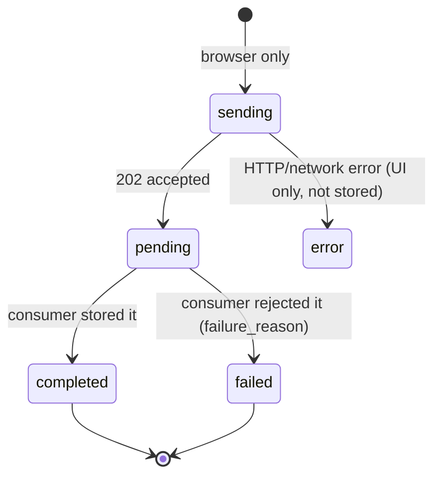
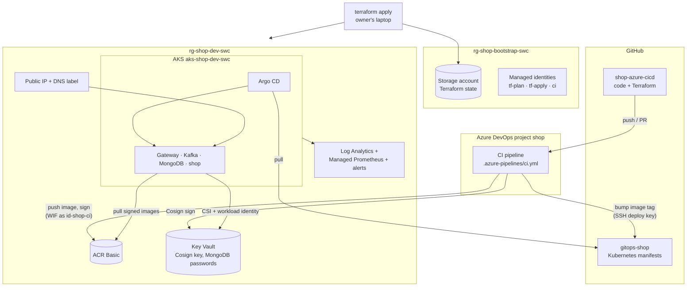
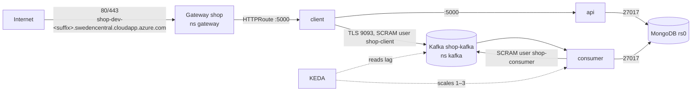
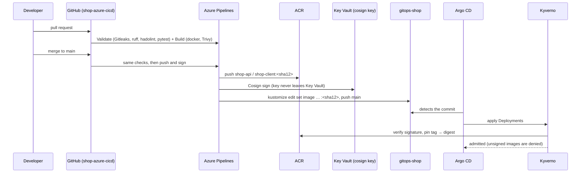

# Architecture

> Status legend used in this file:
> - **Implemented**: code exists in the repository and its tests pass.
> - **Written, not yet deployed**: infrastructure or manifests exist and pass static checks (Terraform validate, schema checks, lint) but have not run end to end in Azure.
> - **On paper**: a design only; nothing is built.

## 1. Repositories and layout

The project uses two GitHub repositories (AD-40):

| Repository | Holds |
|---|---|
| [`shop-azure-cicd`](https://github.com/yaninagroisman/shop-azure-cicd) (this one) | Application code, Dockerfiles, compose, Terraform, the CI pipeline, documentation |
| [`gitops-shop`](https://github.com/yaninagroisman/gitops-shop) | Kubernetes desired state, deployed by Argo CD |

```
shop-azure-cicd/
├── client/                 Shop front (Flask + Jinja2 + CSS + vanilla JS) and Kafka producer: Implemented
│   ├── app/                routes (pages, POST /api/buy, GET /api/purchases proxy), catalog, money, templates, static
│   ├── producer.py         idempotent Kafka producer, waits for its own delivery report
│   ├── kafka_config.py     Kafka connection settings from env (PLAINTEXT or SASL/SCRAM + TLS)
│   ├── tests/              75 tests (12 of them Playwright browser tests)
│   └── Dockerfile          python:3.12 slim, Gunicorn, non-root UID 10001
├── api/                    Purchases API + Kafka consumer (one image, two commands): Implemented
│   ├── app.py              GET /purchases, /healthz, /readyz
│   ├── consumer.py         at-least-once consumer, idempotent insert, retries, dead-letter topic
│   ├── database.py         MongoDB access and indexes
│   ├── kafka_config.py     same as in client/
│   ├── tests/              36 tests
│   └── Dockerfile          python:3.12 slim, Gunicorn, non-root UID 10001
├── compose.yaml            local full stack: mongodb, kafka, kafka-init, api, consumer, client: Implemented
├── ruff.toml               lint rules (ruff 0.17.6 pinned)
├── .azure-pipelines/ci.yml CI: lint, tests, image build, Trivy, push, Cosign signing, GitOps tag bump: Written, not yet run
├── terraform/
│   ├── bootstrap/          remote state, pipeline identities, Azure DevOps project, budget: Applied 2026-11-27
│   ├── environments/dev/   the whole dev environment (one apply / one destroy): Written, applied once (see §5.6)
│   └── modules/            network, aks, acr, key-vault, workload-identity, monitoring, gateway-ip, argocd
├── docs/                   this documentation
├── REPORT.md               detailed Russian work log of the frontend (historical)
└── optional-concepts/      concept images and old helper scripts (not deployed)
```

## 2. Application architecture (implemented)

Reads are synchronous (the API reads MongoDB). Writes are asynchronous (the shop front publishes to Kafka; a consumer writes to MongoDB). This is the pattern the course requires.



Only the client is reachable from outside. The browser calls same-origin `/api/*` URLs, so CSP stays `connect-src 'self'` and no CORS is needed (D-004).

### 2.1 Write flow



The consumer writes the order (D-015): there is no `pending` row in MongoDB and no dual write. The browser keeps the `pending` purchase from the 202 until the stored one appears.

### 2.2 Read flow



### 2.3 Order status model



`sending`, `error` and `pending` exist only in the browser. MongoDB stores `completed` and `failed`.

### 2.4 Kafka

| Item | Value |
|---|---|
| Topics | `purchases` (3 partitions), `purchases.dlq` (1 partition); auto-creation disabled |
| Producer | client, `POST /api/buy`: `acks=all`, `enable.idempotence=true`, 5 s delivery timeout → 503 |
| Consumer group | `purchase-consumers` |
| Message key | `purchase_id`, so every event of an order lands on one partition |
| Delivery | at least once: the offset is committed only after the message is handled |
| Security | local: PLAINTEXT. AKS: TLS listener 9093 with SCRAM-SHA-512 users and ACLs (AD-23), settings from env (`kafka_config.py`) |

### 2.5 Error handling and idempotency

- **Idempotency:** a unique index on `purchase_id`. A redelivered message raises `DuplicateKeyError`, which counts as handled.
- **Business-rule failures** (unknown product, bad quantity): stored as `failed` with `failure_reason`; the shopper sees the reason in the Ledger.
- **Poison messages** (not JSON, no `purchase_id`, rejected by MongoDB): copied to `purchases.dlq`, then committed, so a partition never blocks.
- **Transient failures** (MongoDB or Kafka down): exponential backoff up to 30 s, seek back to the same message, keep polling so the consumer stays in its group.
- **Health:** api `/healthz` (process up) and `/readyz` (MongoDB answers); client `/healthz`; the consumer touches a heartbeat file that its probe checks.

| Failure | Behaviour |
|---|---|
| Kafka down at `POST /api/buy` | 503 `{"error": "Purchase service unavailable"}`; the UI shows the error |
| Consumer down | orders stay `pending` in the browser; they are stored when it restarts |
| MongoDB down at `GET` | 503; the Ledger shows its error banner |
| Duplicate delivery | no duplicate document |
| Invalid slug or quantity | 400 or 404 from `POST /api/buy` |

## 3. Local deployment (implemented)

`docker compose up` starts the whole stack (see [DEPLOYMENT.md](DEPLOYMENT.md) §1): `mongodb`, `kafka` (KRaft, single node), the one-shot `kafka-init` that creates the topics, `api`, `consumer` and `client` (published on port 8080). Every service has a health check, and `depends_on` conditions order the start. Kafka and MongoDB publish no host ports.

## 4. Frontend internals (implemented)

| Concern | Where |
|---|---|
| App factory, `asset()` content-hash URLs, CSP and security headers | `client/app/__init__.py` |
| Settings from env: `API_MODE`, `POLL_INTERVAL_MS` | `client/app/config.py` |
| Page routes only | `client/app/routes.py` |
| Product data (13 products, 4 categories) | `client/app/catalog.py` |
| Coinage: 1 Griffin = 12 Shards = 240 Pips, integer Pips | `client/app/money.py`, mirrored in `static/js/shop.js` |
| Single backend seam | `static/js/api.js` (`window.ShopAPI`) |
| Basket and checkout (sequential `buy` per line) | `static/js/basket.js` |
| Order tracking and polling | `static/js/shop.js` (`Shop.track`, `Shop.onUpdate`) |
| Ledger (`/orders`) | `static/js/ledger.js` |
| Door mini-game | `static/js/game.js`, `templates/partials/game.html` |
| Visual effects and easter eggs | `static/js/magic.js`, `static/js/effects.js` |

## 5. Azure architecture (written, not yet deployed end to end)

All decisions are in [DECISIONS.md](DECISIONS.md) (AD-xx).

### 5.1 Overview



### 5.2 Terraform stacks

| Stack | Lifetime | Creates |
|---|---|---|
| `bootstrap/` | Once, kept for the whole project | State storage (Entra ID only, ZRS, versioning, lock); managed identities `id-shop-tf-plan`, `id-shop-tf-apply`, `id-shop-ci` federated with Azure DevOps service connections (no secrets); `tf-apply` gets Contributor + RBAC Administrator limited by an ABAC allow-list of roles; Azure DevOps project, service connections, environment `dev` with approval; budget |
| `environments/dev/` | One apply / one destroy | Resource group, VNet + NSG, AKS, ACR, Key Vault (Cosign key, MongoDB passwords), workload identities (api, consumer, mongodb, kyverno), monitoring, Gateway public IP, Argo CD extension, root Application |

Details: [terraform/bootstrap/README.md](../terraform/bootstrap/README.md), [terraform/environments/dev/README.md](../terraform/environments/dev/README.md).

### 5.3 Inside the cluster

| Namespace | Contents | Source in `gitops-shop` |
|---|---|---|
| `argocd` | Argo CD (AKS extension) and the root Application | Terraform |
| `cert-manager` | cert-manager v1.21.3, Gateway API support | `apps/templates/cert-manager.yaml` (upstream chart) |
| `strimzi` | Strimzi operator 1.3.1, watches `kafka` and `shop` | `apps/templates/strimzi.yaml` (upstream chart) |
| `kyverno` | Kyverno 1.20 (chart 3.10.0) with workload identity for ACR | `apps/templates/kyverno.yaml` (upstream chart) |
| `gateway` | Gateway `shop` (HTTP 80 → redirect, HTTPS 443), Let's Encrypt ClusterIssuers | `platform/gateway/` |
| `kafka` | Kafka `shop-kafka` 4.3.2 (one KRaft node, TLS + SCRAM, ACLs), topics, entity operator | `platform/kafka/` |
| `shop` | client, api, consumer (KEDA 1–3 replicas on lag), MongoDB StatefulSet, KafkaUsers, SecretProviderClasses, HTTPRoute | `shop/`, `platform/mongodb/` |
| cluster-wide | Image signature verification, NetworkPolicies, Kafka CA copy into `shop` | `platform/policies/`, `platform/kafka/cluster-ca-to-shop.yaml` |



Every arrow is an explicit NetworkPolicy rule; everything else is denied (AD-43).

### 5.4 Delivery (GitOps)



### 5.5 Identities and secrets

| Who | How it authenticates | What it can do |
|---|---|---|
| Azure Pipelines (`ci`) | Workload identity federation, no secret | AcrPush, Crypto User on the Cosign key only, Reader on the dev resource group |
| Azure Pipelines → `gitops-shop` | SSH deploy key (Secure File) | Push to that repository only |
| `tf-plan` / `tf-apply` | Workload identity federation | Read-only / Contributor + limited role assignment |
| Pods api, consumer, mongodb | Workload identity (federated ServiceAccount) | Read their MongoDB secret(s) in Key Vault |
| Kyverno | Workload identity | AcrPull (to read signatures) |
| Kafka clients | SCRAM users created by Strimzi; passwords only in Kubernetes Secrets | ACLs per user: client writes `purchases`; consumer reads `purchases`, writes `purchases.dlq` |
| People | Entra ID (no local accounts) | Cluster admin through Azure RBAC; API server only from the allow-listed IP |

### 5.6 Deployment status

- `bootstrap/` was applied on 2026-11-27 and is in use.
- `environments/dev/` was applied once on 2026-11-28: 57 of 58 resources were created. The root Application could not be applied because the cluster had no free CPU (capacity finding in [DECISIONS.md](DECISIONS.md)). The environment was destroyed the same day.
- The GitOps manifests and the CI pipeline have passed static checks only (kustomize build, kubeconform against Kubernetes 1.33 plus CRD schemas, `helm lint`, hadolint, Gitleaks); they have not run in Azure.

## 6. Production design (on paper)

What a production environment would change, if quota and budget allowed:

| Area | dev | production design |
|---|---|---|
| Cluster | 1 pool, 2 × D2ads_v5, Free tier | Standard tier (SLA), system pool + user pool across 3 zones, cluster autoscaler, automatic patch upgrades with surge |
| API server | public + IP allow-list | private cluster or API Server VNet Integration, access through a jumpbox/VPN |
| Kafka | 1 node, RF 1 | 3 brokers + 3 controllers across zones, RF 3, `min.insync.replicas` 2 |
| MongoDB | 1-member replica set, no backup | 3-member replica set across zones, scheduled backups, or a managed service |
| ACR | Basic | Premium: private endpoint, geo-replication, retention policy |
| Key Vault | public endpoint, RBAC | private endpoint, purge protection |
| Delivery | direct push to `main`, automatic | promotion through pull requests per environment, manual approval for production |
| Observability | 30-day logs, 0.25 GB/day cap | longer retention, dashboards and SLO alerts |
