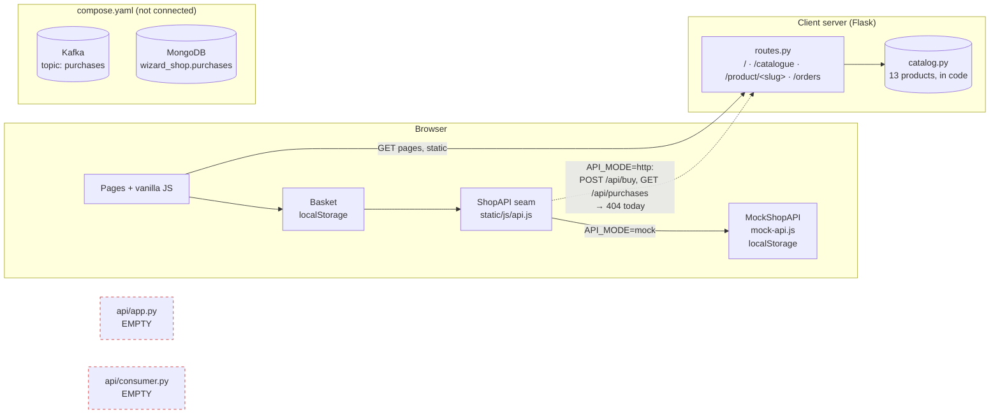
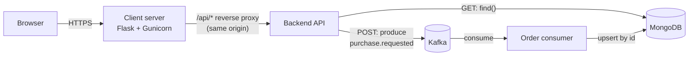
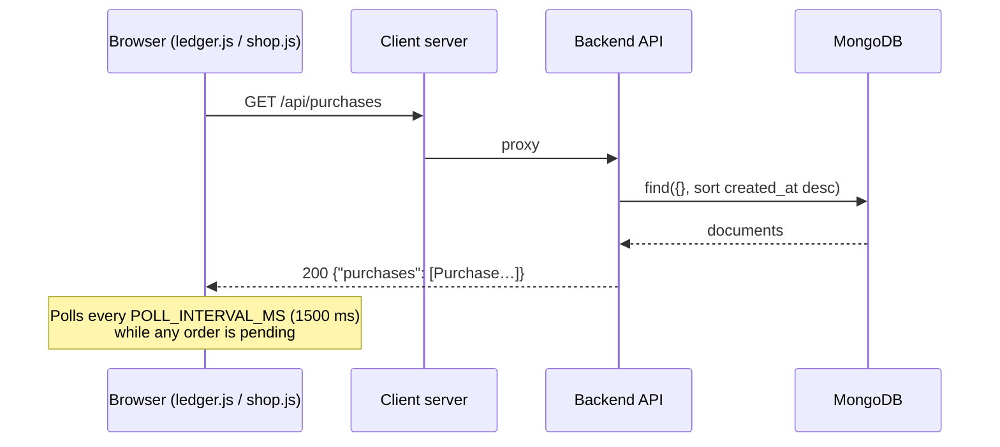
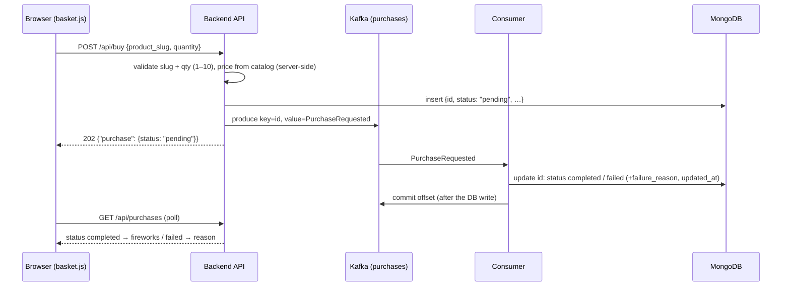
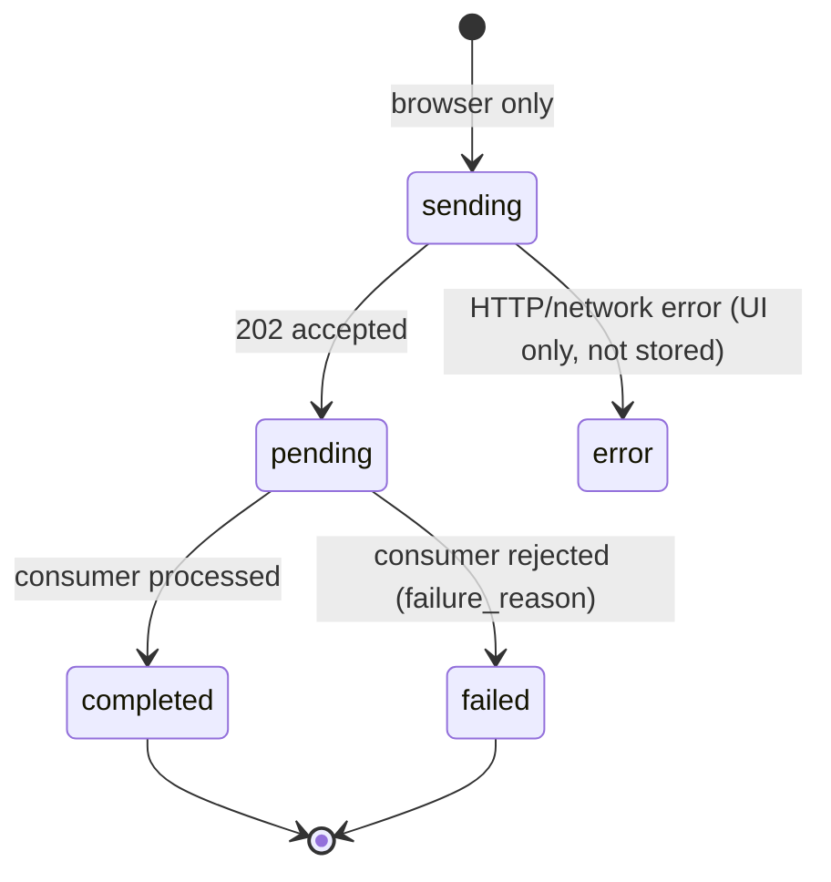

# Architecture

> Status legend used in this file:
> - **Implemented**: code exists in the repository and was observed working on 2026-11-25.
> - **Present, not wired**: infrastructure or code exists but is not connected to anything.
> - **Target (proposed)**: not implemented. It needs an ADR in [DECISIONS.md](DECISIONS.md) before it is built.

## 1. Repository layout

```
<project root>/
├── client/                 Frontend / Client Server (Flask + Jinja2 + CSS + vanilla JS): Implemented
│   ├── tests/              pytest + Playwright suite (64 tests)
│   ├── requirements-dev.txt pytest, Playwright (dev only)
│   ├── wsgi.py             app = create_app()
│   ├── requirements.txt    Flask==3.1.3
│   └── app/                routes, catalog, money, templates, static (see README.md)
├── api/                    Backend API + Kafka consumer: skeleton only (written by the owner)
│   ├── app.py              EMPTY (0 bytes)
│   ├── consumer.py         EMPTY (0 bytes)
│   ├── database.py         pymongo helpers: save_purchase(), get_all_purchases()
│   ├── requirements.txt    EMPTY (pymongo is imported but not declared)
│   └── Dockerfile          python:3.12-slim, CMD python app.py
├── compose.yaml            mongodb (mongo:8.0) + kafka (apache/kafka:4.1.2, KRaft): Present, not wired
├── docs/                   this documentation
├── REPORT.md               detailed Russian work log of the frontend (historical)
├── ASSETS.md               asset register (sources, licences) and image guide
└── optional-concepts/      concept images; tools/ (image pipeline, old checks); source-png/ (masters, git-ignored)
```

The Backend API, MongoDB and Kafka are in the same repository. No other repositories were made available for the audit.

## 2. Current architecture (as of 2026-11-25)



What actually works:

- **Read path (pages):** the browser sends `GET` to Flask, which renders Jinja2 templates using the product data in `catalog.py`. There is no database read.
- **Write path (orders), mock mode (default):** `ShopAPI.buy()` is answered by `mock-api.js` inside the browser. It stores the order in `localStorage` as `pending` and later flips it to `completed`/`failed`, about 10% failing, after 3–7 s. This imitates the asynchronous flow.
- **Write path, http mode:** the browser calls same-origin `/api/buy` and `/api/purchases`. Nothing serves them (Flask returns 404), and the UI shows its error states.
- **Kafka and MongoDB** run as containers. Topic `purchases` (3 partitions) and consumer group `shop-consumers` exist, and `wizard_shop.purchases` holds 1 manual test document. They were created by code that is no longer in the repo. Nothing in the current code talks to them.

## 3. Target architecture (proposed)

The required pattern comes from the course brief:

- **Reads are synchronous:** the API reads MongoDB.
- **Writes are asynchronous:** the API publishes to Kafka, and a consumer writes to MongoDB.



Why same-origin `/api/*`: the frontend already calls relative URLs, CSP is `connect-src 'self'`, and no hostnames are hard-coded. Proxying keeps that true and avoids CORS. Whether Flask or a separate reverse proxy does the proxying is open (to decide in P1-14).

### 3.1 Read flow (target)



### 3.2 Write flow (target)



Open design point: the `pending` row could be written by the API (shown above) or by the consumer.

- **API writes it:** the order shows up immediately and read-your-writes is consistent. But the API then writes to MongoDB as well as Kafka, which is a dual write. Without an outbox it can leave a `pending` row whose message was never sent.
- **Consumer writes it:** writes are purely asynchronous. But `GET /api/purchases` may not list the order for a moment. The UI copes, because it tracks the id it got from the 202.

This must be decided in an ADR (proposed **D-015**) together with P1-02.

### 3.3 Order status model



`sending` and `error` exist only in the UI. Only `pending`, `completed` and `failed` are stored.

### 3.4 Kafka (target)

| Item | Proposal | Today |
|---|---|---|
| Topic | `purchases` | exists: 3 partitions, RF 1 |
| Producer | Backend API, `POST /api/buy` | none in repo |
| Consumer group | `shop-consumers` | group exists, no code |
| Message key | purchase `id`, so all events for an order stay ordered on one partition | — |
| Value | JSON `PurchaseRequested` (below) | — |
| Delivery | at-least-once: commit the offset after the DB write | — |

```jsonc
// PurchaseRequested (proposed, v1)
{
  "schema": 1,
  "id": "9f1c…",              // generated by the API (UUID4 hex); idempotency key
  "product_slug": "pocket-fluffs",
  "product_name": "Pocket Fluffs",
  "quantity": 2,
  "unit_price": 300,           // Pips, priced by the server, never by the browser
  "total_price": 600,
  "created_at": "2026-11-25T10:00:00Z"
}
```

### 3.5 Error handling, retries, idempotency, consistency (target)

- **Idempotency:** the consumer updates or upserts by `id` (unique index), so a redelivered message never creates a second order.
- **Retries:**
  - Transient DB errors: retry with backoff inside the consumer, and do not commit the offset.
  - Poison messages (invalid schema): mark the order `failed` with a reason, or send the message to a dead-letter topic (`purchases.dlq`, to be decided).
  - The browser never retries `POST /api/buy` automatically. The user can retry by placing a new order.
- **Consistency:** eventual. The UI already polls until the order reaches a final state.
- **Ordering:** guaranteed per order, because messages are keyed by id. There is no global ordering, and none is needed.
- **Failure scenarios to test:**

  | Failure | Expected behaviour |
  |---|---|
  | Kafka down at `POST` | 503 JSON error; the UI shows the error state |
  | Consumer down | Orders stay `pending`; they complete when it restarts |
  | MongoDB down at `GET` | 503; the Ledger shows its error banner |
  | Duplicate delivery | No duplicate rows |
  | Invalid slug or quantity | 400 |

### 3.6 Security boundaries

See [SECURITY.md](SECURITY.md). In short:

- Only the client server is public.
- The API, Kafka and MongoDB stay on a private network.
- The browser is untrusted. Prices, game scores and basket contents must be checked or recomputed server-side.

## 4. Frontend internals (implemented)

| Concern | Where |
|---|---|
| App factory, `asset()` content-hash URLs, CSP and security headers | `client/app/__init__.py` |
| Settings from env: `API_MODE`, `POLL_INTERVAL_MS` | `client/app/config.py` |
| Page routes only | `client/app/routes.py` |
| Product data (13 products, 4 categories) | `client/app/catalog.py` |
| Coinage: 1 Griffin = 12 Shards = 240 Pips, integer Pips | `client/app/money.py`, mirrored in `static/js/shop.js` |
| Single backend seam | `static/js/api.js` (`window.ShopAPI`) |
| Basket and checkout (sequential `buy` per line) | `static/js/basket.js` |
| Order tracking and polling | `static/js/shop.js` (`Shop.track`, `Shop.onUpdate`) |
| Ledger (`/orders`) | `static/js/ledger.js` |
| Door mini-game | `static/js/game.js`, `templates/partials/game.html` |
| Visual effects and easter eggs | `static/js/magic.js`, `static/js/effects.js` |
