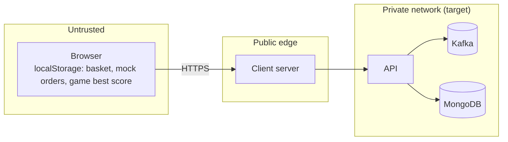

# Security

> **Not production ready.** No security audit has been performed (P5-03).

## Implemented (verified 2026-11-25 from response headers and code)

- `Content-Security-Policy`:

  ```
  default-src 'self'; img-src 'self' data:; style-src 'self' 'unsafe-inline';
  script-src 'self'; connect-src 'self'; font-src 'self'; frame-ancestors 'none';
  base-uri 'self'; form-action 'self'
  ```

  There are no inline scripts and no third-party origins. Fonts are self-hosted.
- `X-Content-Type-Options: nosniff` and `Referrer-Policy: same-origin`.
- `frame-ancestors 'none'` gives clickjacking protection.
- No secrets in the repository, based on an informal grep on 2026-11-25. **This is not a scan** (see P5-11).
  - Configuration comes from environment variables (`API_MODE`, `POLL_INTERVAL_MS`, `MONGO_URI`).
  - `.gitignore` excludes `.env`.
- The browser sends only `product_slug` and `quantity`, never prices.
- MongoDB and Kafka publish **no host ports** in `compose.yaml`.

## Trust boundaries



Everything in the browser can be edited by the user. That includes the basket, quantities, the game's best score and mock orders. The server must validate and recompute everything it accepts.

## Known gaps

| Gap | Impact | Planned in |
|---|---|---|
| Flask dev server (`flask run`) used for the preview | Not for production | P1-13 (Gunicorn) |
| No TLS, no HSTS | Local only today | P2-12 |
| MongoDB without authentication, Kafka PLAINTEXT | Acceptable only on a private network | P2-09, P2-10 |
| No authentication and no rate limiting on the future API | Anyone can list all orders or spam orders | P4-01, P4-13; rate limit proposed with P1-02 |
| No CSRF token | Low today: JSON POST on the same origin with no auth cookies. It becomes relevant with logins | P4-13 |
| Game scores and rewards only client-side | Trivially fakeable | P4-34 |
| `api/requirements.txt` empty, no dependency audit | Unpinned installs | P1-02, P5-04 |
| Unused 80 MB PNGs served publicly from `/static` | Leaks source assets, wastes bandwidth | PX-02 |
| `style-src 'unsafe-inline'` | Needed for inline `style` attributes; low risk without inline scripts | Review in P5-03 |

## Rules for contributors

- Never commit real passwords, tokens, API keys or connection strings. Use env vars or a secret store, and put examples in a `.env.example` with placeholder values.
- Never trust prices, quantities or scores from the browser.
