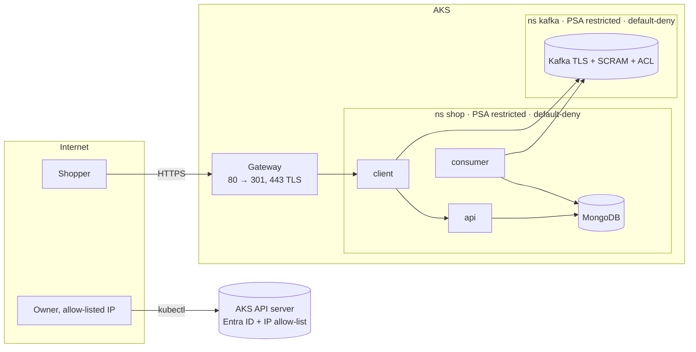

# Security

> **Not production ready.** No formal security audit has been performed (P5-03). The Azure controls below are written in Terraform and the GitOps repository but have not yet run end to end (see [ARCHITECTURE.md](ARCHITECTURE.md) §5.6).

## 1. Application (implemented)

- Strict `Content-Security-Policy`:

  ```
  default-src 'self'; img-src 'self' data:; style-src 'self' 'unsafe-inline';
  script-src 'self'; connect-src 'self'; font-src 'self'; frame-ancestors 'none';
  base-uri 'self'; form-action 'self'
  ```

  No inline scripts, no third-party origins, self-hosted fonts.
- `X-Content-Type-Options: nosniff`, `Referrer-Policy: same-origin`, `frame-ancestors 'none'` (clickjacking).
- The browser sends only `product_slug` and `quantity`. The server prices every order from its own catalog and validates quantity (1–10); the consumer checks the business rules again.
- JSON errors without stack traces; MongoDB timeouts of 3 s so a database outage cannot hang requests.
- Containers: pinned base image (`python:3.12.16-slim-trixie`), fully pinned Python dependencies, Gunicorn, non-root user UID 10001, tests excluded from the images.
- Local compose: Kafka and MongoDB publish no host ports.

## 2. Supply chain and CI (written, not yet run)

| Control | Where |
|---|---|
| Secret scan of every change (Gitleaks); the full history was scanned on 2026-11-28 with 0 findings | `.azure-pipelines/ci.yml` |
| Lint (ruff, hadolint) and tests on every pull request | `.azure-pipelines/ci.yml` |
| Image vulnerability scan: Trivy fails the build on fixable CRITICAL/HIGH | `.azure-pipelines/ci.yml` |
| Images signed with Cosign; the private key is a non-exportable Key Vault key | CI + `terraform/modules/key-vault` |
| Kyverno `ImageValidatingPolicy` in Enforce mode: images from our ACR must carry our signature; tags are pinned to digests | `gitops-shop/platform/policies/verify-images.yaml` |
| Pinned tool versions (ruff, hadolint, Trivy, Cosign with checksum, kustomize) | `.azure-pipelines/ci.yml` |
| Pipelines from forks get no service connection; the `ci` connection is usable from `main` only | bootstrap Azure DevOps settings |

## 3. Identity and secrets on Azure (written, applied in part)

- **No long-lived credentials anywhere:** Azure Pipelines uses workload identity federation; pods use AKS workload identity; people use Entra ID. AKS local accounts are disabled.
- **Least privilege:**
  - `tf-apply` may assign only an allow-list of roles (ABAC condition): it cannot grant Owner or role-administration roles.
  - `ci` has AcrPush, Crypto User on the Cosign key only, and Reader on the dev resource group.
  - The deploy key for `gitops-shop` can write to that repository only.
  - Each pod identity reads only its own Key Vault secret(s).
- **Secrets never in Git, pipeline YAML, images or Terraform state:**
  - MongoDB passwords are generated as ephemeral values and written to Key Vault through write-only attributes.
  - Pods read them through the Key Vault CSI driver.
  - Kafka SCRAM passwords are generated by Strimzi inside the cluster.
- **State storage:** Entra ID only (no shared keys), versioning, soft delete, delete lock.

## 4. Network and cluster (written, not yet run)



- **Only the Gateway is public:**
  - The node NSG allows inbound 80/443 only.
  - Port 80 serves the ACME HTTP-01 challenge and the redirect to HTTPS.
  - TLS uses Let's Encrypt certificates issued by cert-manager.
- **API server:** public endpoint with Entra ID + Azure RBAC and an IP allow-list. **Accepted risk:** AKS Run Command is enabled so that Terraform can apply the root Application (AD-39); it goes through ARM and bypasses the allow-list, but still needs Entra ID and Kubernetes RBAC.
- **NetworkPolicies:** default-deny ingress and egress in `shop` and `kafka`; only the flows in [ARCHITECTURE.md](ARCHITECTURE.md) §5.3 are allowed (AD-43). A CiliumNetworkPolicy lets the Strimzi entity operator reach the API server.
- **Pod Security Admission:** `restricted` in `shop` and `kafka`; `baseline` (warn/audit `restricted`) in `gateway`.
- **Kafka:** TLS-only listener, SCRAM-SHA-512 users, `simple` authorization with per-user ACLs (the client writes `purchases`; the consumer reads `purchases` and writes `purchases.dlq`).
- **MongoDB:** authentication on, replica set keyfile, an application user `shop-app` with `readWrite` on `wizard_shop` only.
- **Argo CD UI:** not exposed; reached only through `kubectl port-forward` (AD-38).

## 5. Trust boundaries

Everything in the browser can be edited by the user: the basket, quantities, the game's best score and mock orders. The server validates and recomputes everything it accepts.

## 6. Known gaps and accepted risks

| Gap | Impact | Status |
|---|---|---|
| No authentication on the shop; every visitor sees every purchase | Acceptable only for a demo | P4-01, P4-15 |
| No rate limiting on `POST /api/buy` | Order spam possible | open question (DECISIONS.md) |
| No HSTS header | Browsers may try HTTP first; the Gateway redirects | P2-12 |
| No CSRF token | Low today: same-origin JSON POST without auth cookies | P4-13 |
| Game scores only client-side | Trivially fakeable | P4-34 |
| `style-src 'unsafe-inline'` | Needed for inline `style` attributes; low risk without inline scripts | review in P5-03 |
| Key Vault and ACR public endpoints (RBAC only) | Microsoft-hosted agents have no fixed IP; ACR Basic has no network rules | accepted for dev (AD-15, AD-36) |
| `tf-plan` can read MongoDB passwords (refresh reads secret values) | Plans run in pull requests; forks get no service connection | accepted, documented |
| Cosign signatures without a transparency log | Verification relies on the key only | accepted (AD-16) |
| AKS Run Command enabled | Bypasses the IP allow-list (still Entra ID + RBAC) | accepted (AD-39) |
| No dependency audit (`pip-audit`) | Trivy scans the images, not the Python lock files | P5-04 |

## 7. Rules for contributors

- Never commit real passwords, tokens, API keys or connection strings. Use environment variables, Key Vault or Kubernetes Secrets; examples go in `*.example` files with placeholders.
- `terraform.tfvars` and `backend.hcl` are git-ignored: keep subscription IDs, IPs and e-mail addresses there.
- Never trust prices, quantities or scores from the browser.
